# Cashu Sync user flows

The diagrams show what users see and what each wallet does during the checked flows. The individual TLC reports list the rules each chart checks. [Verification results](results.md) · [Source inventory](README.md)

## Pair a second device

The host confirms pairing after the joining wallet imports the authority and sends an acknowledgement. A refused replacement preserves the current wallet.

[Open full-size SVG](charts/pairing.svg) · [Mermaid source](charts/pairing.mmd) · [TLC report](charts/pairing-report.md)

Mermaid text

~~~mermaid
---
title: "Pair a second device"
---
stateDiagram-v2
  s0: Sync devices
  s1: Pairing needs attention
  s2: Pairing QR ready
  s3: Host closed the pairing screen
  s4: Joining wallet waits for a response
  s5: Joining wallet checks the authority
  s6: Joining wallet imported
  s7: Existing wallet preserved
  s8: Joining wallet sent confirmation
  s9: Wallet imported, host confirmation uncertain
  s10: Pairing cancelled on joining wallet
  s11: Both wallets paired
  [*] --> s0
  s0 --> s1: Link is invalid or expired
  s0 --> s2: Show pairing QR
  s2 --> s3: Leave pairing screen
  s2 --> s1: Link is invalid or expired
  s2 --> s4: Scan or open the pairing link
  s1 --> s3: Leave pairing screen
  s4 --> s1: No response before deadline
  s4 --> s5: Host sends encrypted wallet authority
  s5 --> s1: Joining wallet cannot start
  s5 --> s6: Joining wallet starts with that authority
  s5 --> s7: Different wallet contains local data
  s6 --> s8: Joining wallet confirms the import
  s6 --> s9: Relay could not confirm receipt
  s7 --> s10: Keep current wallet
  s8 --> s11: Host receives acknowledgement
~~~

## Buy credits

The wallet shows the invoice, records credits once it is paid and updates the balance and history.

[Open full-size SVG](charts/buy.svg) · [Mermaid source](charts/buy.mmd) · [TLC report](charts/buy-report.md)

Mermaid text

~~~mermaid
---
title: "Buy credits"
---
stateDiagram-v2
  s0: Wallet
  s1: Enter amount
  s2: Requesting invoice
  s3: Saving invoice
  s4: Lightning invoice
  s5: Check sync before paying
  s6: Invoice paid, ready to claim
  s7: Claiming credits
  s8: Credits recorded
  s9: Recovering your purchase
  s10: Credits bought and synchronized
  [*] --> s0
  s0 --> s1: Tap Buy credits
  s1 --> s2: Request invoice
  s2 --> s1: Could not request invoice
  s2 --> s3: Invoice received
  s3 --> s1: Wallet changed elsewhere
  s3 --> s4: Invoice ready
  s3 --> s5: Relay did not confirm the invoice
  s4 --> s6: Pay the Lightning invoice
  s6 --> s7: Claim credits or automatic claim
  s7 --> s6: Another payment settled first
  s7 --> s8: Mint confirms credit
  s7 --> s9: Payment status still unknown
  s8 --> s10: Balance and history updated
  s9 --> s6: Another payment settled first
  s9 --> s8: Mint confirms credit
~~~

## Spend credits or top up an eSIM

A paid quote closes the dialog. An unpaid quote keeps the dialog open and offers a retry.

[Open full-size SVG](charts/spend.svg) · [Mermaid source](charts/spend.mmd) · [TLC report](charts/spend-report.md)

Mermaid text

~~~mermaid
---
title: "Spend credits or top up an eSIM"
---
stateDiagram-v2
  s0: Wallet
  s1: Enter amount or paste invoice
  s2: Requesting spend quote
  s3: Saving spend quote
  s4: Review amount and fee
  s5: Check sync before paying
  s6: Paying
  s7: Payment confirmed
  s8: Unpaid, journal cleared
  s9: Recovering your spend
  s10: Credits spent and synchronized
  s11: Invoice unpaid, retry available
  [*] --> s0
  s0 --> s1: Tap Top up or Pay invoice
  s1 --> s2: Get spend quote
  s2 --> s1: Invalid amount, invoice or quote unavailable
  s2 --> s3: Quote received
  s3 --> s1: Wallet changed elsewhere
  s3 --> s4: Quote ready
  s3 --> s5: Relay did not confirm the quote
  s4 --> s6: Confirm spend
  s6 --> s4: Another payment settled first
  s6 --> s7: Mint confirms payment
  s6 --> s8: Mint says unpaid and inputs are released
  s6 --> s9: Payment status still unknown
  s7 --> s10: Wallet closes the spend dialog
  s8 --> s11: Wallet shows the unpaid invoice
  s9 --> s4: Another payment settled first
  s9 --> s7: Mint confirms payment
  s9 --> s8: Mint says unpaid and inputs are released
  s11 --> s4: Review the quote again
~~~

## Reconnect after missing updates

When history is pruned, the wallet asks the mint which tokens remain usable. An unconfirmed relay save can leave the correction on the local device.

[Open full-size SVG](charts/snapshot-sync.svg) · [Mermaid source](charts/snapshot-sync.mmd) · [TLC report](charts/snapshot-sync-report.md)

Mermaid text

~~~mermaid
---
title: "Reconnect a wallet after missing updates"
---
stateDiagram-v2
  s0: Local wallet opens
  s1: Looking for changes from other devices
  s2: Wallet synchronized
  s3: Local wallet preserved
  s4: Old relay history gone, checking tokens
  s5: Mint confirms spendable tokens
  s6: Saving reconciled wallet
  s7: Correction retained on this device
  [*] --> s0
  s0 --> s1: Open, reconnect or switch back to wallet
  s1 --> s2: Apply verified wallet state or No newer wallet state
  s1 --> s3: Cannot safely verify newer state
  s1 --> s4: Relay no longer retains the full history
  s3 --> s1: Retry synchronization
  s4 --> s3: Cannot safely verify newer state
  s4 --> s5: Keep usable tokens and quarantine pending ones
  s5 --> s6: Send correction to relay
  s6 --> s7: Relay could not confirm correction
  s6 --> s2: Relay confirms correction
~~~

## Back up, restore or remove a wallet

Restore preserves a different funded wallet and needs a usable relay snapshot for a remembered wallet. Removal waits for a confirmed relay save.

[Open full-size SVG](charts/authority-recovery.svg) · [Mermaid source](charts/authority-recovery.mmd) · [TLC report](charts/authority-recovery-report.md)

Mermaid text

~~~mermaid
---
title: "Back up, restore or remove this wallet"
---
stateDiagram-v2
  s0: Recovery settings
  s1: Reading backup
  s2: Encrypted backup downloaded
  s3: Checking wallet before removal
  s4: Checking the configured mint
  s5: Wallet preserved, action needs attention
  s6: Fetching wallet state
  s7: Relay backup confirmed
  s8: Wallet restored
  s9: Preparing empty local wallet
  s10: Wallet removed from this device
  s11: Resuming the previous payment
  [*] --> s0
  s0 --> s1: Choose backup and enter passphrase
  s0 --> s2: Download with matching passphrases
  s0 --> s3: Confirm removal from device
  s1 --> s4: Device is empty
  s1 --> s5: Cannot decrypt backup or Device already has a different wallet
  s1 --> s6: Backup belongs to this wallet
  s2 --> s1: Choose backup and enter passphrase
  s3 --> s5: Payment pending or backup unconfirmed
  s3 --> s7: Relay confirms saved wallet
  s4 --> s5: Mint unavailable or incompatible
  s4 --> s9: Mint passed the check
  s5 --> s1: Choose backup and enter passphrase
  s6 --> s5: Relay restore failed, retry possible
  s6 --> s8: Start wallet with no remembered backup or Relay snapshot loaded
  s7 --> s10: Clear device data
  s6 --> s11: Local payment still needs recovery
  s9 --> s6: Open wallet from backup
~~~

## Open the wallet and recover a payment

Connecting to the relay starts a check. The journal result determines whether the wallet shows synchronized or recovering.

[Open full-size SVG](charts/browser-lifecycle.svg) · [Mermaid source](charts/browser-lifecycle.mmd) · [TLC report](charts/browser-lifecycle-report.md)

Mermaid text

~~~mermaid
---
title: "Open the wallet and recover a payment"
---
stateDiagram-v2
  s0: Starting synchronized wallet
  s1: Wallet ready
  s2: Startup needs attention
  s3: Recovering previous payment
  s4: Pair or restore this wallet
  s5: Checking wallet sync
  s6: Reconnecting wallet
  [*] --> s0
  s0 --> s1: Wallet state is ready
  s0 --> s2: Wallet startup failed
  s0 --> s4: No wallet profile
  s0 --> s3: Find an unfinished payment
  s1 --> s5: Relay socket connects
  s1 --> s6: Relay connection drops
  s2 --> s1: Previous payment resolved
  s3 --> s1: Previous payment resolved
  s3 --> s5: Relay socket connects
  s3 --> s6: Relay connection drops
  s5 --> s1: Wallet confirms the journal is clear or Previous payment resolved
  s5 --> s3: Wallet finds an unresolved payment
  s5 --> s6: Relay connection drops
  s6 --> s5: Relay socket connects
  s1 --> s0: App update reloads the page
  s2 --> s0: App update reloads the page
  s6 --> s1: Previous payment resolved
  s3 --> s0: App update reloads the page
  s4 --> s0: App update reloads the page
  s5 --> s0: App update reloads the page
  s6 --> s0: App update reloads the page
~~~

## Two wallets coordinate a payment

One wallet wins the relay write. It saves the accepted checkpoint before sending. A peer reads the submitted request and recovers the result. This chart shows a melt with device A winning the claim. The full check also explores mint, legacy prepared heads and either winner.

[Open full-size SVG](charts/operation-journal.svg) · [Mermaid source](charts/operation-journal.mmd) · [TLC report](charts/operation-journal-report.md)

Mermaid text

~~~mermaid
---
title: "How paired wallets coordinate a payment"
---
stateDiagram-v2
  s0: Wallet ready
  s1: Payment prepared
  s2: Stopped before sending
  s3: Relay accepted the submission
  s4: Waiting to confirm the relay save
  s5: Winning wallet saved its submission locally
  s6: A wallet is recovering the payment
  s7: Mint reports payment pending
  s8: Mint result saved locally
  s9: Payment request sent
  s10: Relay saved the result
  s11: Payment result recorded on device
  [*] --> s0
  s0 --> s1: Prepare payment
  s1 --> s2: Relay rejected the submission
  s1 --> s3: One wallet wins the relay write
  s1 --> s4: Relay acknowledgement lost
  s2 --> s1: Prepare payment
  s3 --> s5: Save the accepted submission on the winning device
  s3 --> s6: Read the saved submission and check the mint or Continue from the journal after an interruption
  s4 --> s6: Read the saved submission and check the mint
  s5 --> s6: Read the saved submission and check the mint or Continue from the journal after an interruption
  s5 --> s9: Send the prepared payment
  s6 --> s7: Record the mint result
  s6 --> s8: Record the mint result
  s7 --> s8: Record the mint result
  s8 --> s10: Save the result to the relay
  s9 --> s6: Read the saved submission and check the mint or Continue from the journal after an interruption
  s9 --> s7: Record the mint result
  s9 --> s8: Record the mint result
  s10 --> s11: Read the saved result
~~~

## Regenerate

Use pstack `/statechart` in a temporary directory. Set `STATECHART` to the installed `scripts/statechart` executable. The [verification report](results.md) describes how to reuse the pinned TLC jar.

| Flow | Module | Config | View |
|---|---|---|---|
| Pair a second device | [Pairing.tla](../../verification/pairing/Pairing.tla) | [Pairing.cfg](../../verification/pairing/Pairing.cfg) | [view.mjs](../../verification/pairing/view.mjs) |
| Buy credits | [WalletPayments.tla](../../verification/wallet-payments/WalletPayments.tla) | [Buy.cfg](../../verification/wallet-payments/Buy.cfg) | [buy.mjs](../../verification/wallet-payments/buy.mjs) |
| Spend credits or top up an eSIM | [WalletPayments.tla](../../verification/wallet-payments/WalletPayments.tla) | [Spend.cfg](../../verification/wallet-payments/Spend.cfg) | [spend.mjs](../../verification/wallet-payments/spend.mjs) |
| Reconnect after missing updates | [SnapshotSync.tla](../../verification/snapshot-sync/SnapshotSync.tla) | [SnapshotSync.cfg](../../verification/snapshot-sync/SnapshotSync.cfg) | [view.mjs](../../verification/snapshot-sync/view.mjs) |
| Back up, restore or remove a wallet | [AuthorityRecovery.tla](../../verification/authority-recovery/AuthorityRecovery.tla) | [AuthorityRecovery.cfg](../../verification/authority-recovery/AuthorityRecovery.cfg) | [view.mjs](../../verification/authority-recovery/view.mjs) |
| Open the wallet and recover a payment | [BrowserLifecycle.tla](../../verification/browser-lifecycle/BrowserLifecycle.tla) | [BrowserLifecycle.cfg](../../verification/browser-lifecycle/BrowserLifecycle.cfg) | [view.mjs](../../verification/browser-lifecycle/view.mjs) |
| Two wallets coordinate a payment | [OperationJournal.tla](../../verification/operation-journal/OperationJournal.tla) | [Chart.cfg](../../verification/operation-journal/Chart.cfg) | [view.mjs](../../verification/operation-journal/view.mjs) |

From the repository root:

~~~sh
scratch=$(mktemp -d)
cp verification/pairing/Pairing.tla verification/pairing/Pairing.cfg verification/pairing/view.mjs "$scratch/"
cd "$scratch"
"$STATECHART" Pairing.tla --config Pairing.cfg --view view.mjs --out "$scratch/output"
~~~

The SVGs use Pele 1.9.0. The views collapse steps that leave the display unchanged. The pairing view shows screen closure at the QR and error checkpoints. The browser view omits camera and service worker installation steps. The charts describe safety within their configured bounds.
